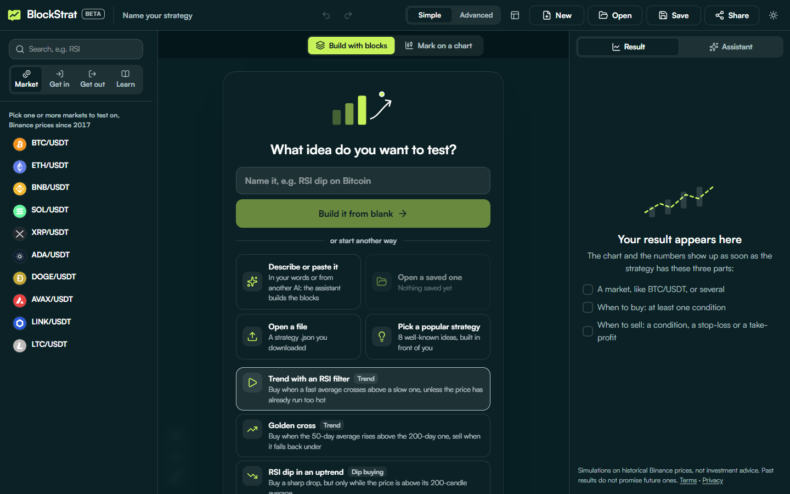
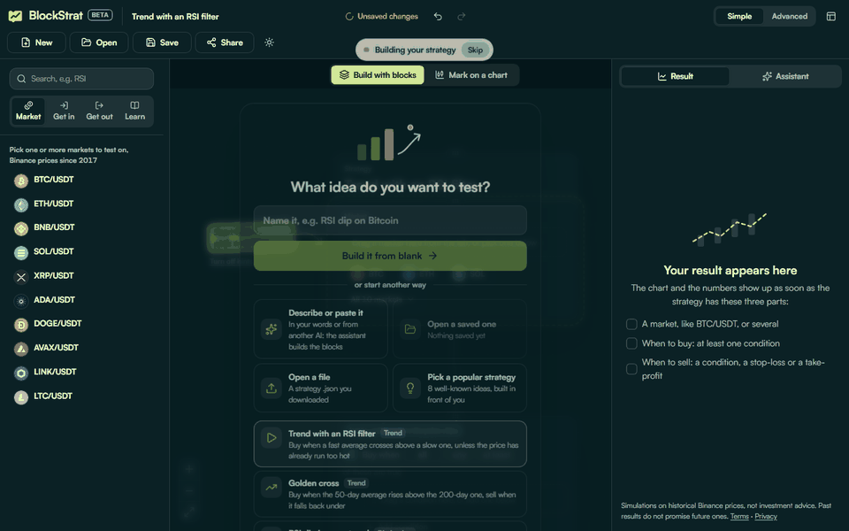
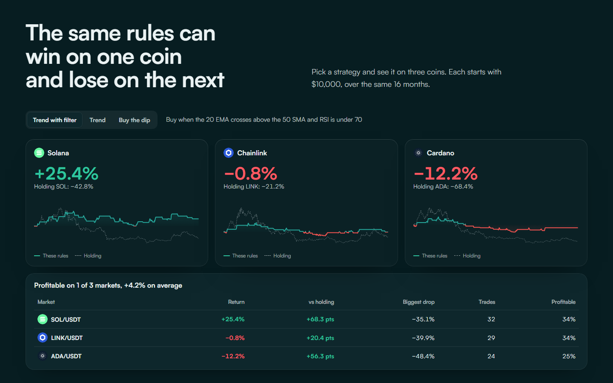
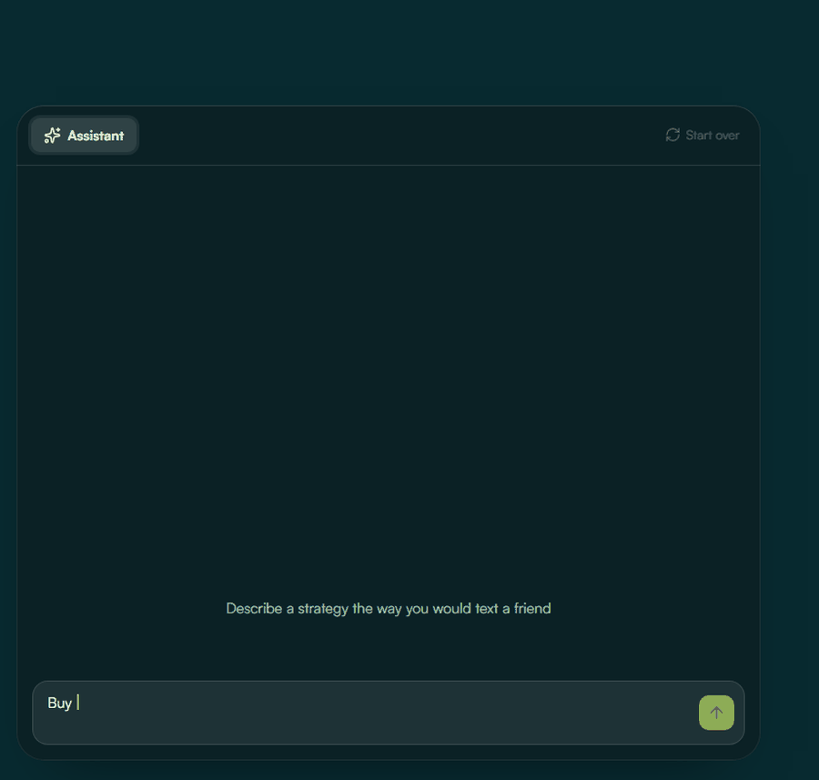
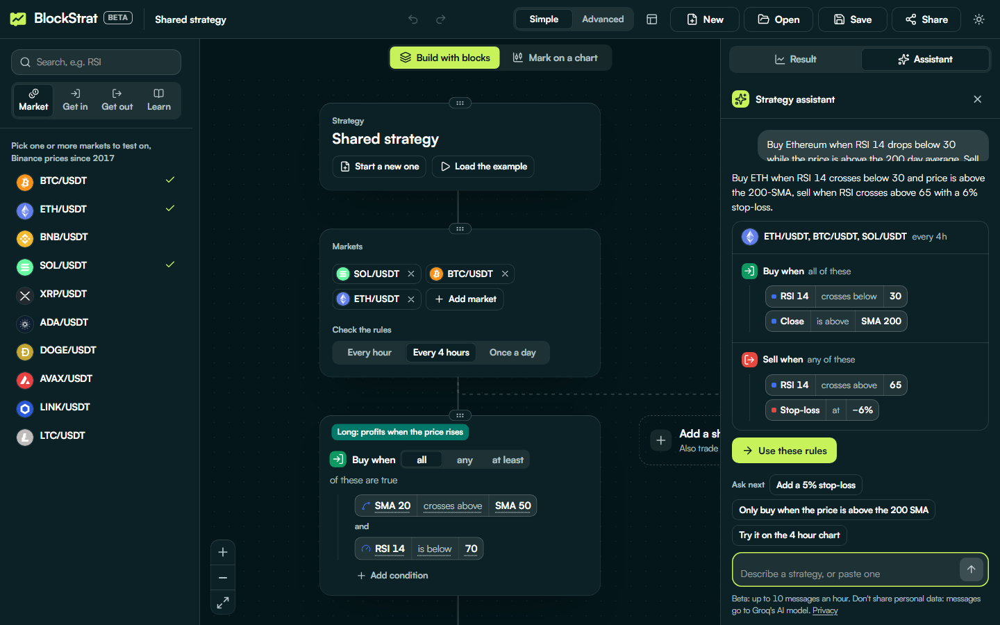

  

<h1 align="center">BlockStrat</h1>

  <strong>Test a trading idea before you risk money on it.</strong>
   
  Build a crypto strategy from blocks, or just describe it, and see how it would have done on years of real Binance prices.
    
  <a href="https://blockstrat.vercel.app"><strong>Open BlockStrat →</strong></a>
   
  Beta · Free for personal use · No sign-up · Open source (AGPL-3.0)

## Why it exists

Most trading ideas sound good in a video or a tweet: "buy when RSI drops below 30", "follow the golden cross". Very few people check them before putting money in, because checking means writing code or clicking through a spreadsheet for hours.

BlockStrat does the checking for you in seconds. You put the idea together from blocks you can read, it replays the idea on real past prices, fees included, and tells you plainly what would have happened: how much you would have made or lost, how deep the worst drop was, and whether simply buying and holding the coin would have done better.

It helps you to:

- **Drop bad ideas cheaply.** Find out that a "sure thing" lost 30% over the last year on the coin you wanted to trade, before it costs you anything.
- **See the real cost of trading.** Every trade pays commission and slippage, so a strategy that trades too often shows up as the fee machine it is.
- **Know the pain before the gain.** The worst drop from a high is shown next to the return, so you know whether you could actually sit through it.
- **Check whether it only worked by luck.** Run the same rules on several coins at once and see if they hold up or only fit one chart.
- **Learn what the indicators mean.** Every block has a plain explanation and a chart that shows what it measures.

BlockStrat never places orders, never asks for exchange keys and never touches your money. It is a simulator, not investment advice.

## How it works

### 1. Pick an idea, or start from a popular one

Name your idea and build it from scratch, describe it to the assistant, open a saved one, or start from one of eight well-known strategies: trend with an RSI filter, golden cross, RSI dip in an uptrend, MACD momentum, Bollinger bounce, breakout with volume, two of three agree, and trend both ways.

### 2. Snap the rules together

A strategy is a few cards: which markets to test on and how often to check the rules, when to buy, and when to sell. Conditions are readable sentences such as *SMA 20 crosses above SMA 50* or *RSI 14 is below 70*, grouped with "all", "any" or "at least N". Add a stop-loss, a take-profit or a trailing stop, and a short side if you want to profit when prices fall.

### 3. Read the verdict

The result updates with every change, in well under a second. You see the profit or loss from a $10,000 start, the number of trades and how many were profitable, the biggest drop, every trade on the price chart, and how the same rules did on each market you picked, side by side with simply holding the coin.

The same rules can win on one coin and lose on the next, so testing on several at once is built in:

## Describe it instead

Not sure which blocks you need? Write the idea the way you would text a friend, or paste a strategy from another AI. The assistant turns it into the same blocks you would snap together, never hidden code, so you can check every rule it set and change any of them. When you ask for something the engine cannot do, it says so instead of guessing.

During the beta the assistant answers up to **10 messages an hour** per visitor.

## Mark trades, get the rules

You know a good trade when you see one. Draw a few on the chart, long or short, the way you would on TradingView: click the entry, click the target, and the stop-loss follows the reward-to-risk you like. BlockStrat tries hundreds of rules and pairs of rules, keeps the ones that would have taken similar trades, and tests each on years of candles, so a rule that only fits your drawing shows it.

## Honest numbers

- **No peeking into the future.** A signal on a candle's close buys at the next candle's open, the price you could really have got.
- **Fees on every trade.** 0.1% commission a side and 0.05% slippage per fill by default, or your exchange's own numbers.
- **Real prices.** Hourly, 4-hour and daily candles of ten large crypto pairs from Binance (BTC, ETH, BNB, SOL, XRP, ADA, DOGE, AVAX, LINK, LTC), back to 2017.
- **The bad parts in plain sight.** The worst drop, the losing trades and the comparison with holding are shown as prominently as the profit.

## Keep, share and take it further

- Strategies are saved in your browser automatically, with undo and redo.
- Download a strategy as a file and open it later, or send a link that opens with the blocks and the result.
- Export the rules as a TradingView Pine Script strategy and paste them into TradingView's Pine Editor.

## Pricing

BlockStrat is in beta and free for personal use, with no account. Using it for a business, such as a fund, a trading firm or a paid course, needs an agreement: write to hakendev@gmail.com.

## License

The code is open source under the [GNU Affero General Public License v3.0](LICENSE), the license of the backtest engine it uses, [backtesting.py](https://github.com/kernc/backtesting.py). You may use, change and share it; if you run a changed version as a service, you must publish your changes under the same license. The BlockStrat name and logo are not covered by the license. The hosted site has its own [Terms of Service](https://blockstrat.vercel.app/terms) and [Privacy Policy](https://blockstrat.vercel.app/privacy).
