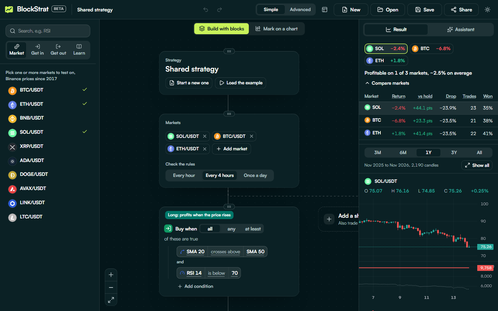
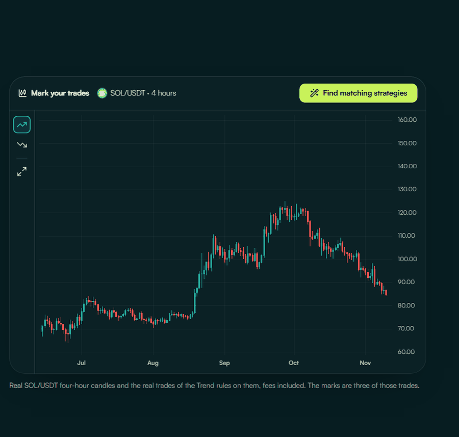

  

<h1 align="center">BlockStrat</h1>

  <strong>Test a trading idea before you risk money on it.</strong>
   
  Build a crypto strategy from blocks, or just describe it, and see how it would have done on real Binance prices.
    
  <a href="https://blockstrat.vercel.app"><strong>Open BlockStrat →</strong></a>
   
  Beta · Free for personal use · No sign-up · Open source (AGPL-3.0)

## Why

"Buy when RSI drops below 30" sounds good in a video. BlockStrat replays an idea like that on years of real prices, fees included, and tells you plainly what would have happened: the profit or loss, the worst drop on the way, and whether simply holding the coin would have done better. No code, no spreadsheet, a few seconds.

BlockStrat never trades and never touches your money. It is a simulator, not investment advice.

## How it works

**1. Start from an idea.** Build it from scratch, describe it to the assistant, or pick one of eight well-known strategies.

**2. Snap the rules together.** Pick the markets, then when to buy and when to sell, from readable blocks like *SMA 20 crosses above SMA 50*. Add a stop-loss or take-profit if you want.

**3. Read the verdict.** Every change replays the test in under a second, on each market you picked, side by side.

## Describe it instead

Write the idea the way you would text a friend. The assistant turns it into the same editable blocks, never hidden code. During the beta it answers up to **10 messages an hour**.

## Mark trades, get the rules

Draw the trades you would have taken on a chart, and BlockStrat finds rules that would have taken similar ones, tested on years of candles.

## License

Free for personal use; business use needs an agreement (hakendev@gmail.com). The code is open source under the [AGPL-3.0](LICENSE). See the site's [Terms](https://blockstrat.vercel.app/terms) and [Privacy Policy](https://blockstrat.vercel.app/privacy).
