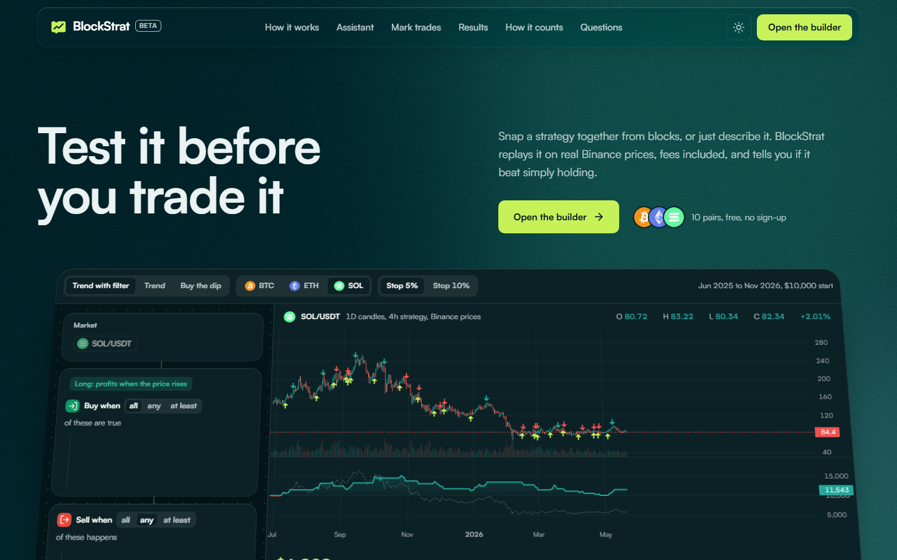

<p align="center">
  
</p>

<h1 align="center">BlockStrat</h1>

<p align="center">
  Build a crypto trading strategy from blocks, or describe it in a sentence, and see how it would have done on real Binance prices.
  <br>
  <a href="https://blockstrat.vercel.app"><strong>blockstrat.vercel.app</strong></a> · Beta · Free for personal use · AGPL-3.0
</p>



## What it does

- **Blocks, not code.** A strategy is a market, a timeframe, a rule to buy and a rule to sell, snapped together from blocks: SMA, EMA, RSI, MACD, Bollinger Bands, Stochastic, highs and lows, price change and volume, with and/or groups, stop-loss, take-profit and trailing stops, long and short sides.
- **Backtests on real prices.** Hourly, 4-hour and daily candles of ten large crypto pairs from Binance, back to 2017. Every change replays the test in well under a second, on several markets at once.
- **Honest numbers.** Orders fill at the next bar's open, so nothing peeks into the future, and commission and slippage are counted on every trade.
- **AI assistant.** Describe an idea in plain words and the assistant (a Groq-hosted model) answers with editable blocks, never code. It says so when you ask for something the engine cannot do.
- **Mark trades on a chart.** Draw the trades you would have taken and get strategies whose rules would have taken similar ones.
- **Save, share, export.** Strategies stay in your browser, download as JSON, export to TradingView Pine Script, and share as a link that opens with the result.


BlockStrat never places orders, never connects to an exchange and is not investment advice. Results are simulations on past prices.

## Beta limits

The hosted site limits each visitor to **10 assistant messages an hour** (and a daily total for everyone), plus generous hourly limits on backtests, charts and strategy searches. Self-hosted, every limit is an environment variable (see [backend/.env.example](backend/.env.example)).

## Architecture

```
Nuxt 4 + Tailwind (Vercel)          ──HTTPS──▶   FastAPI (VPS, Coolify)
  /         landing page (prerendered)             strategy schema (Pydantic) ──▶ JSON Schema ──▶ TS types
  /app      builder (Vue Flow, lightweight-charts) Binance klines ──▶ parquet cache
  /terms    /privacy                               backtesting.py engine (ADR 0002)
                                                   Groq structured output, rate limits per IP
```

Domain terms: [GLOSSARY.md](GLOSSARY.md). Decisions: [docs/adr](docs/adr).

## Run locally

Requirements: [uv](https://docs.astral.sh/uv/) and Node.js 22+.

```bash
cp backend/.env.example backend/.env
cp frontend/.env.example frontend/.env
```

Put a free Groq key from [console.groq.com/keys](https://console.groq.com/keys) in `backend/.env` for the assistant; everything else works without it.

```bash
cd backend && uv run uvicorn blockstrat.api:create_default_app --factory --port 8000
```

```bash
cd frontend && npm install && npm run dev
```

Open http://localhost:3000 for the landing page and http://localhost:3000/app for the builder. On its first start the backend downloads the Binance price history (about a minute) and caches it in `backend/data/`.

## Tests

```bash
cd backend && uv run pytest
```

```bash
cd frontend && npm test && npm run typecheck
```

After changing the backend schema, regenerate the frontend types:

```bash
cd frontend && npm run gen:types
```

## Deploy

Backend on Coolify, frontend on Vercel, both deploying `main` on push: see [docs/deployment.md](docs/deployment.md).

## License

The code is licensed under the [GNU Affero General Public License v3.0](LICENSE), the license of its backtest engine, [backtesting.py](https://github.com/kernc/backtesting.py). You may use, change and share it; if you run a changed version as a service, you must publish your changes under the same license.

The hosted site at [blockstrat.vercel.app](https://blockstrat.vercel.app) is free for personal use; business use needs an agreement, see its [Terms of Service](https://blockstrat.vercel.app/terms). The BlockStrat name and logo are not covered by the code license.
